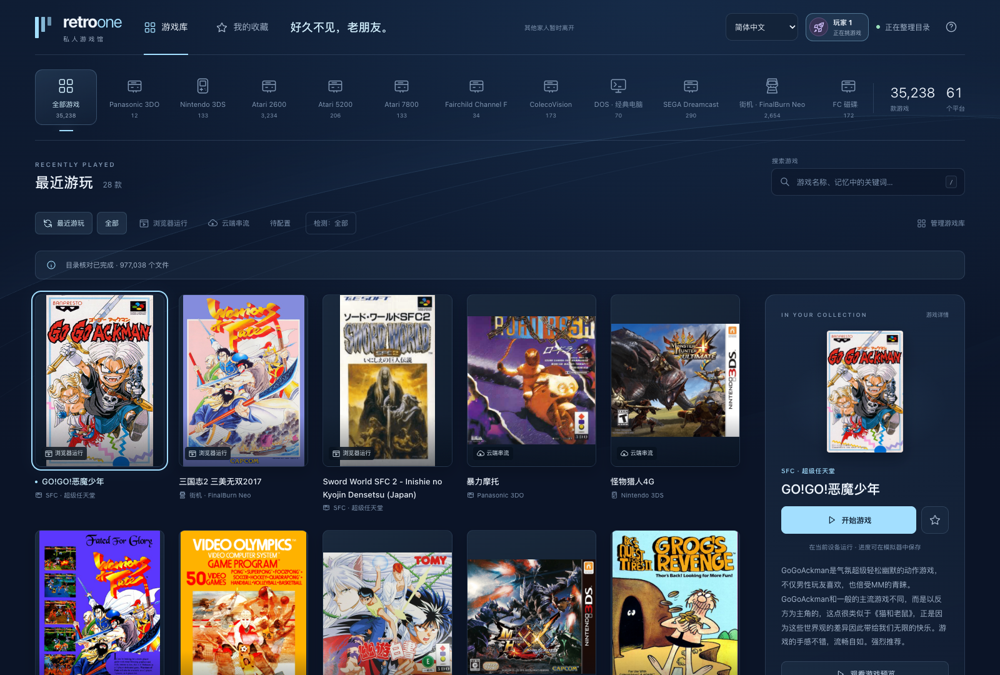
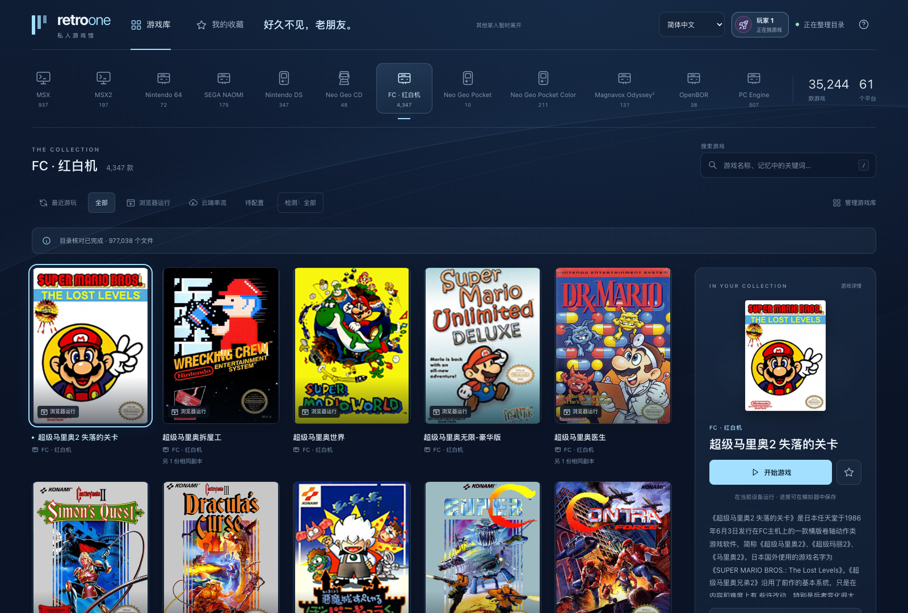
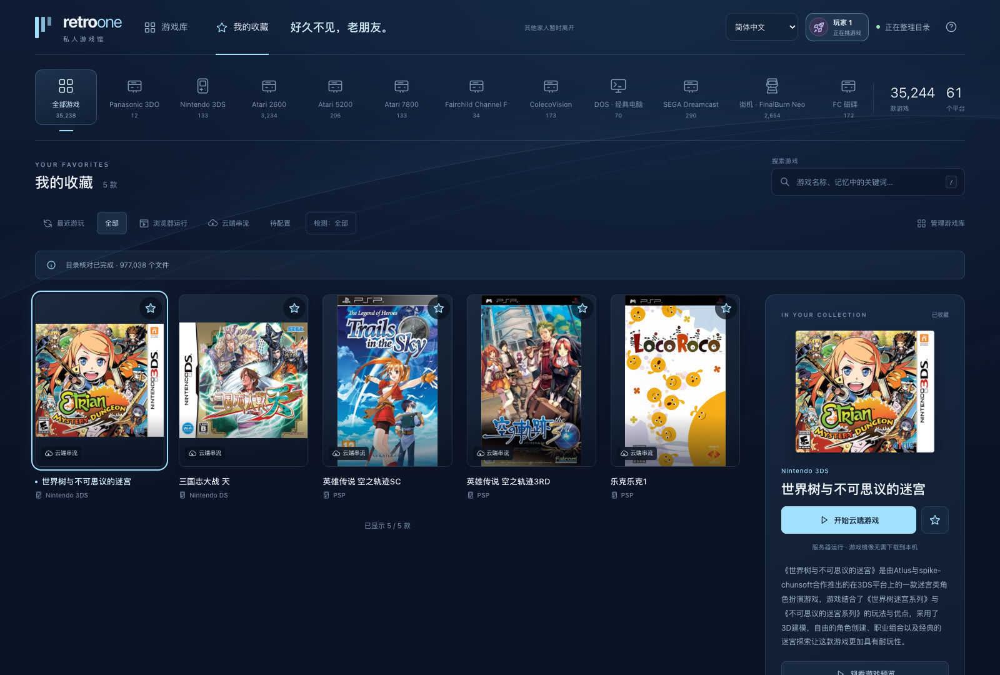
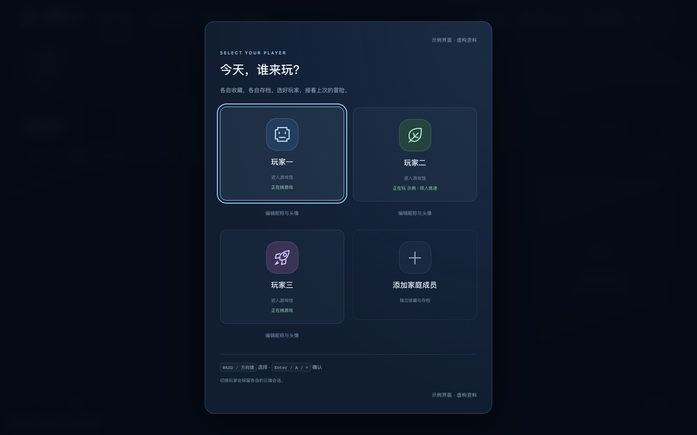
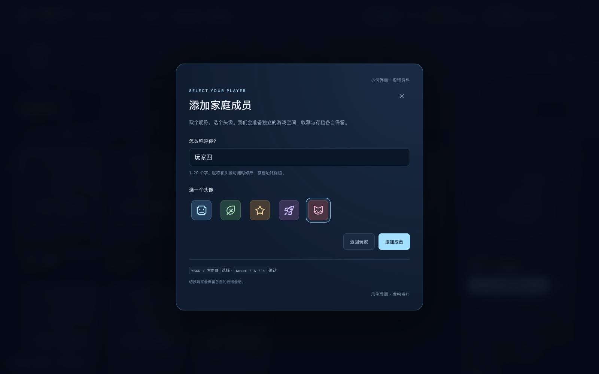
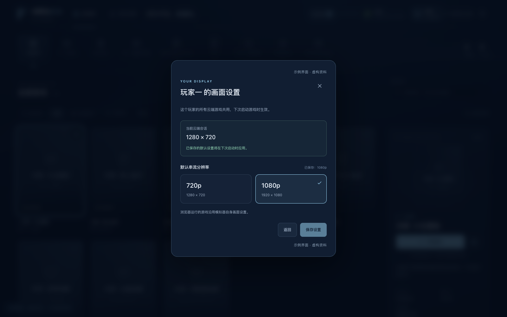
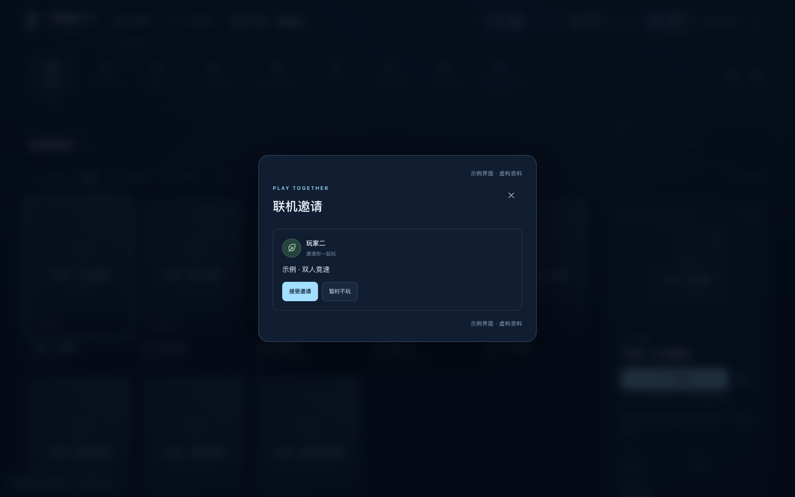

# RetroOne · 私人游戏馆

**把多年收藏放进一个网页，和家人接着玩。**

RetroOne 是面向家庭局域网的怀旧游戏库。它读取你自己的 ROM 目录，将平台分类、搜索、收藏、玩家档案和游戏启动放在同一个入口里：小型游戏可以在浏览器本地模拟，大型游戏由家中的服务器运行，再把画面与声音传到浏览器。

界面采用主机式导航，打开即支持键盘和手柄。底层复用 EmulatorJS、RetroArch、Selkies 等开源项目；运行环境封装为 Docker 镜像，由多个家庭成员实例复用。

**English overview**

RetroOne is a self-hosted retro gaming hub for families on a home network. Browse your own ROM collection through a console-style web interface with search, favorites, and keyboard or gamepad controls. Supported lightweight games run locally in the browser; other games run on the server and stream to your browser when the required emulator is configured. Each family member has a separate profile, saves, and display preferences, with online activity visible from the home screen.

Built on EmulatorJS, RetroArch, and Selkies, RetroOne uses Docker for deployment. Bring your own games and any required BIOS, firmware, or keys—none are included. The public image provides the application and streaming foundation; additional emulator runtimes must be prepared locally as described in the [build and release guide](docs/releasing.md).

Library management keeps metadata, ROM-linked launch configurations, and personal saves separate. Resumable content audits identify exact cartridge duplicates while preserving variants and original save identities; audit results distinguish file checks from actual emulator observations.

The interface supports **English**, **简体中文**, and **Browser default**. Use the language selector in the top bar or on the player selection screen. Each player’s preference is saved on the server; switching languages keeps the current game running. Game titles, descriptions, and save identities retain their original values.

On phones, touch controls adapt to the game platform, with landscape side controls and a portrait layout below the picture. The play menu offers fullscreen, aspect-preserving or horizontal-stretch presentation, and button size/opacity settings. Install the PWA from a supported HTTPS browser for a standalone window. Games still require a connection; the offline page does not cache ROMs or saves. See [mobile play](docs/mobile-play.md) for setup and limitations.

下面三张截图来自实际家庭游戏库，展示已有的最近游玩、单个平台和个人收藏。游戏标题、封面、排序与数量取自真实目录；成员昵称仅在截图页面中作匿名化处理，没有修改服务器资料。

**最近游玩：接着上次的冒险。**



**按平台浏览：集中查看一台主机的收藏。**



**我的收藏：把常玩的游戏放在一起。**



> 这些截图展示游戏库浏览，不代表其中每款游戏均通过运行或性能验证。后文的成员、邀请和画面设置截图使用虚构演示资料，并标为“示例”。封面仅随界面截图展示；仓库及公开镜像不提供 ROM、BIOS、固件或密钥，也不会替用户下载游戏。

## 可以用它做什么

- **浏览自己的收藏**：按平台查找游戏，搜索名称，查看最近游玩和个人收藏；缺少封面时使用应用自带的文字卡片。
- **一个入口，两种运行方式**：轻量游戏在浏览器运行；大型镜像留在服务器，通过串流游玩。
- **全家各有进度**：自选昵称和头像，独立收藏、最近记录、设置与存档；首页“＋”可添加成员。
- **看看谁在玩**：顶栏显示在线家人的头像与活动，本人的状态入口可以继续、结束游戏或调整画面设置。
- **键盘和手柄导航**：支持 WASD、方向键、Xbox 和 PlayStation 手柄，无需先打开手柄模式。
- **手机也能玩**：全屏播放、按平台切换的触控按键、横竖屏布局及 PWA 安装；按键大小、透明度和画面比例可在游玩菜单调整。
- **保留原收藏**：游戏库只读挂载，运行时需要的解压副本和存档写到独立数据目录。
- **管理与核验收藏**：后台扫描、生成每游戏启动配置、分批检查内容指纹和重复副本；保留衍生版本及原存档入口。详见 [游戏库管理](docs/library-management.md)。

## 游戏在哪里运行

| 运行方式 | 选择条件 | 客户端做什么 |
| --- | --- | --- |
| 浏览器运行 | 文件及解压后总大小均不超过 **20 MiB**，有已安装的浏览器核心，满足固件条件，且是可直接加载的单文件内容 | 下载这份小型内容，在当前设备模拟 |
| 云端串流 | 超过阈值，或内容不适合浏览器加载，且服务器运行环境已就绪 | 接收画面和声音，将操作传回服务器，不下载大镜像 |
| 待配置 | 缺少核心、固件、启动入口，或该系统尚未接入 | 显示原因，保留收藏条目 |

**入库不等于逐款可玩。** 多文件光盘、街机依赖包和 PC 游戏不能只凭压缩文件大小判断。默认串流目标为 720p、60 FPS，实际表现取决于原作帧率、模拟器、服务器、网络和浏览器解码；项目不会通过加速游戏或音频凑帧率。

## 开始部署

目前云端运行路径面向 **x86-64 Linux、Docker Compose 和 Intel 核显**，需要可用的 `/dev/dri/renderD128`。建议先用少量自己的游戏验证运行、输入和存档，再导入完整收藏。

```sh
git clone https://github.com/zhuzhe1983/retroOne.git
cd retroOne
```

先按照 [部署与维护指南](docs/operations.md#首次部署) 创建数据目录并填写 `.env`，然后选择构建方式：

| 构建方式 | 用途与边界 |
| --- | --- |
| `Dockerfile.public` · 公开入口镜像 | 提供网页、目录 API、家庭档案、串流基础环境及镜像内已安装的系统软件包。不携带私有 `vendor/` 组件，浏览器核心、PSP 等能力可能显示未就绪 |
| `Dockerfile` · 本地完整构建 | 从自己已准备、核验的运行组件构建，接入更多模拟器。仍需自己的游戏和必要固件，也不保证所有系统可玩；此构建用于私有部署 |

无需等待预构建镜像发布，可以先构建公开入口版本：

```sh
docker build -f Dockerfile.public -t retroone:local .
docker compose up -d --no-build
docker compose ps
```

启动后访问 `https://<服务器地址>:8781/`。首次使用需信任本地证书，或接入带可信证书的反向代理；远程使用手柄和多线程浏览器模拟时应保持 HTTPS。普通 HTTP 入口为 `8780`。

预构建镜像标签、发布流程、完整本地构建及依赖校验见 [镜像与发布说明](docs/releasing.md)。公开镜像地址为 `ghcr.io/zhuzhe1983/retroone`，可用标签以仓库的 Releases 为准。

服务按可信家庭网络设计。玩家档案没有密码或 PIN，用于分开进度，不构成公网访问控制。

## 导入自己的 ROM

### 1. 按目录放好文件

将 `RETROONE_ROM_PATH` 指向包含 `library/` 的根目录，例如 `/srv/rom/one`。容器会把它**只读挂载到 `/roms`**。

```text
/srv/rom/one/
├── library/
│   ├── nes/
│   │   └── manual/
│   │       └── 我的FC收藏/
│   │           └── 自有卡带.nes
│   ├── gba/
│   │   └── manual/
│   │       └── 我的掌机收藏/
│   │           └── 自有卡带.gba
│   ├── psx/
│   │   └── manual/
│   │       └── 我的光盘收藏/
│   │           ├── 自有光盘.cue
│   │           └── 自有光盘.bin
│   └── dos/
│       └── manual/
│           └── 我的电脑收藏/
│               └── 自有游戏.zip
└── firmware/
    └── 放置运行所需、由自己提供的 BIOS 和固件
```

**目录层级必须是 `library/<平台>/<来源>/<收藏>/`。** 上例的 `manual` 是来源标签，“我的FC收藏”是收藏名，两者可自行命名。不要省略这两层，也不要把 ROM 直接放到 `library/nes/` 下。

常用平台目录名如下；完整识别规则见 [platforms.py](retroone/platforms.py)。扩展名表示候选文件，并不代表当前镜像一定装有对应模拟器。

| 系统 | 平台目录 | 常见文件 |
| --- | --- | --- |
| FC / SFC | `nes` / `snes` | `.nes` / `.sfc`、`.smc` |
| GB / GBC / GBA | `gb` / `gbc` / `gba` | `.gb` / `.gbc` / `.gba` |
| Mega Drive | `megadrive` | `.md`、`.gen` |
| PlayStation / PSP | `psx` / `psp` | `.cue`、`.chd`、`.m3u` / `.iso`、`.cso`、`.pbp` |
| DOS / Windows | `dos` / `windows` | 游戏压缩包或完整游戏目录，还需确认启动入口 |
| 街机 | `fbneo` / `mame` | 与核心版本匹配的 ROM 集及其依赖 |
| Nintendo Switch | `switch` | `.nsp`、`.xci`、`.nro`；全部云端运行，需本地完整镜像与自己的固件、密钥 |

### 2. 保留关联文件与所需固件

- 小型单卡带 ZIP 可以保留压缩形式，服务会检查解压后的体积。7z 是否可直接运行还取决于内容、核心与解压工具。
- `.cue` 配套的 `.bin`、`.gdi` 的轨道文件，以及 `.m3u` 引用的多碟文件要一起保留，文件名与相对路径需一致。
- 街机 ZIP、父包、BIOS、CHD 不要全部展开或合并，ROM 集必须与对应核心版本相符。
- DOS / Windows 游戏保留完整资源，不要只复制一个 `.exe`。识别不到入口时会显示待配置，不会任意执行目录内程序。
- 需要固件的平台，将自己的文件放入 `one/firmware/`；例如 PS2 BIOS 使用 `one/firmware/pcsx2/`。具体名称和布局取决于模拟器，详见 [维护指南](docs/operations.md#固件与运行组件)。项目不提供这些文件或下载入口。
- Switch 使用 `one/firmware/switch/prod.keys` 和 `firmware.zip`（或 `registered/` 内的 NCA）；详见 [Switch 接入指南](docs/switch-runtime.md#准备自己的游戏与依赖)。NSZ / XCZ 要先转换，更新与 DLC 不能当作游戏本体启动。

### 3. 更新游戏库并检查状态

进入网页、选择玩家，打开 **“管理游戏库”** 并扫描目录。扫描在后台进行，完成后列表自动更新；大目录需要更多时间。管理入口也可分批核验内容、查看进度并继续未完成的指纹任务。也可以调用当前玩家的 `POST /p/playerN/api/scan`。

选择游戏后查看详情中的运行方式和原因。先试一款熟悉的游戏，验证输入、保存和恢复，再继续扩充收藏。移动或重命名已入库文件可能改变游戏 ID，进而影响收藏、最近记录及按游戏 ID 保存的数据关联；已有进度请先备份。

已有 Pegasus 收藏可以保留 `metadata.pegasus.txt` 和媒体目录。自己的封面可按 `media/<ROM文件名去掉扩展名>/boxFront.png` 放在收藏目录内，或在元数据中明确引用；没有图片时仍能正常浏览。独立封面缓存不应随项目代码或公开镜像发布；文档中经确认的界面截图单独记录来源。

## 和家人一起使用

每次打开网页，先选自己的玩家档案。首次使用填写昵称并选头像；也可以点“＋”添加成员。新增成员准备好独立实例后才允许进入，失败时可重试。默认提供两个档案，成员数量上限可以配置，实际并发能力由主机资源决定。

顶栏和玩家选择界面都可以切换 **简体中文 / English / 跟随浏览器**。未选玩家时，选择保存在当前浏览器；选定玩家后，使用这位玩家保存在服务器上的语言偏好。切换语言会立即更新网页，保留正在运行的游戏。浏览器模拟器内部菜单在下次打开时使用所选语言；游戏原文、玩家昵称和存档不受影响。添加翻译见 [界面语言说明](docs/i18n.md)。



<details>
<summary>查看“添加家庭成员”界面示例</summary>



</details>

顶栏直接显示谁在线、正在玩什么。在线状态来自浏览器连接，后台保留着云游戏并不等于这位家人还在线。点击自己的头像和状态，可以继续云游戏、结束云游戏、打开画面设置或切换玩家。

每个玩家最多保留一个云端会话。**关闭播放窗口或网页会保留云游戏；结束游戏需要再次确认。** 如果当前已有游戏运行，切换前会提示游戏名称与未保存风险。选择另一个家庭成员不会替对方结束游戏。

### 键盘与手柄

| 操作 | 键盘 | Xbox / PlayStation 手柄 |
| --- | --- | --- |
| 移动选择 | WASD / 方向键 | 十字键 / 左摇杆 |
| 确认、查看 | Enter | A / × |
| 返回 | Esc | B / ○ |
| 切换平台 | 选择顶部平台按钮 | LB、RB / L1、R1 |
| 搜索 | `/` | 可转用键盘输入 |
| 选择玩家 | 顶栏本人状态 → 切换玩家 | Menu / Options |

连接手柄后按任意键唤醒浏览器检测。进入游戏后使用对应模拟器的映射：浏览器游戏默认 WASD 移动、J/K/U/I 动作、Q/E 肩键、Enter 开始、Shift 选择，可在模拟器中调整；云端按具体系统映射。

### 手机游玩与 PWA

手机进入游戏后自动显示触控手柄：横屏时主要按键靠两侧，竖屏时放在画面下方。点右上角 **☰** 打开游玩菜单，可全屏、切换原比例居中或横向铺满、调整按键大小与透明度，或手动选择布局。浏览器模拟器的存档工具也会随菜单展开。设置保存在这台设备的当前玩家名下，不改变服务器串流分辨率。

通过可信 HTTPS 地址打开 RetroOne，在 **顶栏自己的头像 → 安装应用** 中安装，或使用 Android Chrome 的浏览器安装菜单。安装后可从桌面以独立窗口启动；浏览器不允许系统全屏时仍提供沉浸布局。PWA 不提供离线游戏，断网只显示提示，不缓存 ROM、存档或家庭成员数据；新版本也不会强制刷新正在玩的页面。

详细操作、触控布局和兼容边界见 [手机游玩说明](docs/mobile-play.md)。

### 保存与恢复进度

**浏览器游戏**：普通游戏存档保存在当前浏览器的 IndexedDB 中，并按玩家隔离。模拟器的“保存状态”会下载文件，同时备份到服务器；播放器顶部可以载入、导出或上传状态。服务器备份需要主动保存状态，不是持续同步普通存档。换设备、换域名或清理浏览器数据前，应先备份进度。

**云端游戏**：游戏内存档和模拟器状态保存在该玩家的服务器数据目录。结束前先在游戏内保存；关闭网页本身不等于保存。镜像更新不会代替备份，迁移时应保留完整的 `data/` 和 `profiles/`，因为部分 PC 游戏把存档写在工作副本中。路径与备份方法见 [维护指南](docs/operations.md#存档与备份)。

### 每位玩家通用的画面设置

从 **顶栏本人状态 → 画面设置** 选择 720p 或 1080p。偏好保存在服务器，对这个玩家的所有云端游戏通用；下次新启动时应用，保存设置不会中断或改变当前游戏。



这是串流桌面与视频输出尺寸，**不是 AI 超分，也不是各模拟器内部渲染倍率**。界面区分已保存的偏好和当前会话实际尺寸；无法读取实际尺寸时会明确提示。浏览器运行的游戏继续使用模拟器自己的画面设置。

### 联机：区分同机多人和独立主机联网

**SameConsole（同机多人）**是一个游戏实例连接多个手柄，通常共享画面。**Network（原生联网）**是两套独立实例通过游戏原有网络协议连接，每位玩家有自己的画面和进度。普通 Netplay、两个成员同时开游戏，都不能自动等同于后一种。

目前原生联网采用**实验性、逐条验证的白名单**。私有完整环境中验证过 PSP《山脊赛车2》的两实例同场比赛；公开入口镜像不包含这套 PSP 核心。现有白名单还绑定已核验的目录条目 ID，新目录导入同名游戏不会自动开放邀请，需要开发者重新核验并登记。

对白名单条目，可点击在线家人发出邀请。对方接受后，两人分别明确启动自己的游戏，再按提示在游戏内建房、查找并加入；接受邀请不会自动启动游戏，也不代表已经进入比赛。关闭邀请不会结束正在运行的模拟器。

<details>
<summary>查看邀请界面示例（虚构条目，仅展示交互）</summary>



</details>

## 当前边界

- **3DS**：实验支持，已有实际关卡运行记录，也发现原生保存后重启核心崩溃的问题，尚不能承诺进度恢复稳定。
- **Switch**：已接入 Eden 0.2.1，全部使用云端运行。空界面启动及正常退出已验证；实际游戏的输入、存档恢复、兼容性和帧率仍待具备密钥与匹配固件后验证。公开镜像不含 Eden。默认掌机模式、1 倍内部分辨率；尚未开放 Switch 原生联网。
- **Windows 老游戏**：仅接入少量已明确入口的布局，不能把任意 Windows 游戏当作已支持。DOS 游戏也需保留资源并适配启动方式。
- **NVIDIA**：只有后端适配接口，显卡透传、采集与 NVENC 链路尚未实现，当前不能仅改一个环境变量就迁移成功。
- **帧率与并发**：60 FPS 是串流目标，不是全平台性能保证。成员数量上限不等于能同时运行同样数量的重型游戏。卡顿、声音异常与温度排查见 [性能说明](docs/performance.md)。

## 文档与开发

- [部署、存档、升级与 ROM 整理](docs/operations.md)
- [镜像构建与发布](docs/releasing.md)
- [性能与声音排查](docs/performance.md)
- [架构与 API](ARCHITECTURE.md)
- [联机能力及验证边界](NETWORK_REVIEW.md)
- [Switch 模拟器、依赖准备与验证边界](docs/switch-runtime.md)
- [上游组件、版本与许可证记录](container/UPSTREAM.md)
- [真实图库与示例截图的来源说明](docs/screenshots/README.md)

本地开发可以在 macOS / Linux 启动目录 API 与网页；云端模拟和串流需要 Linux 容器环境。开发启动、检查命令见维护指南。游戏、固件、独立封面缓存、用户数据和本地验收录屏均应留在自己的存储中，不随代码提交或公开发布。文档仅收录截图清单中逐张确认的界面图片。
