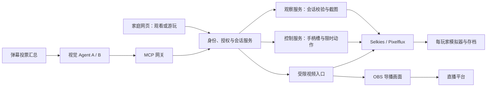

# AI Agent、指定运行方式与家庭观战

状态：**MCP 第一版与家庭云游戏观战已实现。** 当前使用方式、工具参数、鉴权配置与限制以 [MCP 与只读观战](mcp.md) 为准；[正式 Agent Skill](skills/retroone-agent/SKILL.md) 可配合已连接的服务使用。

English: MCP v1 and read-only cloud spectating are implemented. See the [current setup guide](mcp.md) and [agent skill](skills/retroone-agent/SKILL.md). The design record below includes future work and is not a list of shipped features.

以下保留最初的设计记录。**逐人批准观战、玩家踢出观看者、网页单次模式选择、双 Agent 同场验证、Network MCP 工具与弹幕连接器仍属后续范围。** 当前家庭观战由管理员为可信家庭网络开启，点开顶栏家人活动后会显示独立的“观看”按钮；不是在玩家选择窗口点头像。MCP 输入上限为 1000 ms，截图只支持最大宽度，没有裁图参数。

## 最初设计：目标与现状（历史记录）

家人继续按原有规则玩游戏；AI 可以单次指定云端运行，包括 NES 等小型游戏。爸爸可以保留自己的玩家身份和游戏，只读观看儿子的当前云游戏。AI 也可以作为观察者，或在获得授权后控制自己的游戏、同机多人中的一个手柄，或原生联网中的一个独立实例。

| 能力 | 目前已有 | 需要补齐 |
| --- | --- | --- |
| 单次指定运行方式 | launch 接受 `mode: "stream"`，可覆盖小型游戏的浏览器默认方式 | 网页选择入口、MCP 参数、能力与失败原因展示 |
| 玩家与存档隔离 | 每玩家独立云端实例、数据目录、游戏会话 | Agent 专属档案、授权身份与档案的绑定 |
| 观看视频、采集画面 | 所装 Selkies 有 viewer 角色和内部截图 API | 观战授权、会话绑定、网页入口、MCP 图像结果 |
| 多个控制器 | Selkies 可为不同连接分配手柄槽，并在服务端检查槽权限 | 槽占用管理、控制租约、动作接口、真实双角色测试 |
| 原生 Network | PSP《山脊赛车2》通过双实例同场比赛验证 | AI 操作适配；其他游戏逐款核验 |
| 浏览器本地游戏观战 | NAS 无法直接取得客户端模拟画面 | 由游玩浏览器主动发布画面和声音，另做一期 |

代码入口：[启动 API](../retroone/api.py)、[运行方式解析](../retroone/game_config.py)、[模拟器进程管理](../retroone/runner.py)、[现有联机验证](../NETWORK_REVIEW.md)。底层功能存在不等于 RetroOne 的端到端功能已完成。

## 单次选择在哪里运行

保留现有 API 名称，不另加含义相同的 `cloud` 枚举：

| 用户看到的选项 | 请求方式 | 行为 |
| --- | --- | --- |
| 按游戏配置（默认） | 不传 `mode` | 沿用该游戏已保存的运行配置 |
| 自动判断 | `mode: "auto"` | 按内容和平台能力判断；与“不传参数”不完全相同 |
| 浏览器运行 | `mode: "browser"` | 必须满足本地模拟的体积、核心、固件与内容条件 |
| 云端运行 | `mode: "stream"` | 必须有可用的服务器模拟器，ROM 大小不作为排除条件 |

现有单次云端启动请求形状如下，`<profile>` 和 `<game-id>` 是实际游戏库中的标识；当前接口本身并不是新设计的鉴权接口：

```http
POST /p/<profile>/api/games/<game-id>/launch
Content-Type: application/json

{"mode":"stream"}
```

请求覆盖只作用于本次解析，不写成该游戏的持久运行方式。未生成过配置的游戏可能补建默认配置，但不会因此把默认方式改成云端。云端核心缺失或启动失败时返回具体原因，不偷偷改为浏览器运行。

网页拟在详情页提供“本次运行方式”，保留日常一键启动。MCP 新建 AI 游戏默认显式请求 `stream`，否则服务器可能只返回一个浏览器页面，AI 的服务器截图就看不到游戏。

继续同一个云游戏时复用现有会话；参数不是热切换命令。已有其他云游戏时，必须明确选择替换并带上准确的旧会话 ID，先核验新游戏可用性再停止旧游戏。浏览器游戏切换为云端是重新启动，不能假定浏览器即时存档可直接迁移到另一核心。正在玩的人先保存并决定是否切换。

## 家庭观战的使用方式

1. 顶栏点家人头像，显示当前游戏与“观看”。本人仍是爸爸，目标是儿子的某个会话，不能通过切换成儿子档案实现观看。
2. 播放页显示“正在观看 · 儿子 · 游戏名”。提供声音、全屏、仅影响观看端的画面显示设置与退出观看；不加载触控手柄或键盘/手柄控制桥。
3. 儿子能看到正在观看的人，也能关闭分享或移除某位观看者。建议分享设置为“关闭 / 家庭成员 / 仅邀请”，首次默认关闭，经本人开启后记住选择。
4. 爸爸关闭、刷新观看页或退出观看，不结束儿子的游戏；爸爸自己的云游戏也保留。观看不写成爸爸的最近游玩，不占用他的模拟器实例。
5. 游戏结束或切换时，原观看授权失效，画面显示结束状态。不能继续截取桌面、自动跟到下一款游戏，或把旧会话的输入发给新会话。

对于**正在浏览器本地运行**的游戏，第一期明确显示“此游戏在对方设备运行，暂不支持观看”。不能为方便观战自动把对方游戏重启到云端。后续由该浏览器在玩家开启分享后发布 canvas 与音频，经 WebRTC 传送给观看者；届时要单独记录发布设备、会话和分享状态，标签页关闭即停止发布。是否能捕获音频、后台限速和移动设备耗电均需实测。

## 共用一套会话与权限服务



MCP 负责工具调用和截图结果，视频继续走现有串流链路；不把 60 FPS 视频逐帧塞进模型上下文。观察服务供网页观战、AI 看图和导播复用，控制权限单独授予。观看自己的游戏与被允许观看别人的游戏，遵守同一套会话检查。

### 复用现有 Selkies，但补上真正的授权

私有部署安装的 Selkies 已有 `GET /api/screenshot`、`GET /api/sessions`、master 管理的 `POST /api/tokens`，以及 WebSocket / WebRTC 的 viewer 与手柄槽门禁。截图 API 调用 Pixelflux 取得该 worker 的 X11 画面。上述都是内部能力，不能原样对外暴露。

同版本的 [分享说明](https://github.com/selkies-project/selkies/blob/2.0.0/docs/usage.md#session-sharing) 和 [Secure Mode](https://github.com/selkies-project/selkies/blob/2.0.0/docs/secure-mode.md) 可作实现依据。审查时部署未启用 master token：`#shared` 的连接确实不能输入，但去掉片段重新连接可自行选择 controller。因此只隐藏按钮或添加 `#shared` 不能构成跨成员授权。

拟由 RetroOne 在每个 worker 前统一执行授权：

- 引入已配对设备/已认证主体与玩家档案的绑定。人类端可继续使用名字和头像，但第一次授权设备需要家庭管理员或已授权设备完成配对；Agent 使用绑定指定档案和权限的独立凭证。`profile_id`、昵称和设备随机 ID 都不是登录凭证。
- 观看 grant 绑定主体、目标玩家、准确的 `session_id`、权限和到期时间。Selkies observer token 使用 `role: viewer`、无手柄槽、无鼠标键盘控制；master 只留在服务器。
- Selkies 的 token 更新是**整表替换**。每个 worker 由一个 broker 串行汇总和发布，避免新观看者加入时覆盖玩家和其他 Agent 的有效 token。启动恢复时先重建授权状态，不能回退到开放 controller 模式。
- grant 到期、撤销或游戏替换后，由应用撤销底层 token。Selkies 负责连接权限，RetroOne 负责 TTL、身份及游戏会话语义。
- FastAPI 的启动、停止、存档与设置接口同样检查主体和范围。只给串流接口加 token，并不能防止观察者绕道调用旧的 `/p/<profile>/api/...`。
- 受保护入口启用时，旧的匿名控制入口、worker 直连端口及另一种 WS/WebRTC 传输不能绕过授权。远程 MCP 使用 HTTPS、逐请求认证与 Origin 校验；不向模型暴露 master、Docker socket、shell 或任意服务器文件路径。

服务端拒绝观察者的输入、停止、存档写入、上传、分辨率修改和抢占控制。网页的只读按钮布局用于表达权限，真正的限制由服务端执行。以后如果增加“请求接管”，它必须是另一项明确授权。

## MCP 第一版接口草案

采用 [官方 Python SDK](https://github.com/modelcontextprotocol/python-sdk)，作为可选伴随服务接入现有后端，不重写模拟器、视频编码或协议实现。远程优先 Streamable HTTP，拟用 `/mcp`；按目标客户端实测锁定 SDK 与协议版本。MCP 的图像结果可以携带 PNG/JPEG，配合结构化元信息即可完成看图和操作闭环。[工具结果规范](https://modelcontextprotocol.io/specification/2026-07-28/server/tools)、[传输规范](https://modelcontextprotocol.io/specification/2026-07-28/basic/transports)。

以下名称与参数为**待实现契约**。工具发现和调用均按权限过滤；不能把 MCP 的某次 HTTP 连接当成游戏身份或控制权。

| 拟用工具 | 主要参数/返回 | 权限与约束 |
| --- | --- | --- |
| `retroone_capabilities` | 可见档案、平台能力、观察/输入限制、支持的多人方式 | 只返回当前主体范围 |
| `retroone_list_games` | 搜索词、平台、运行方式、可用性、分页 | 不向模型返回 ROM 文件或私有磁盘路径 |
| `retroone_sessions` | 授权可见的会话、游戏、所属玩家、实际模式 | 区分在线的人、后台游戏、AI 与观看者 |
| `retroone_launch` | game/profile、`mode=stream`、request ID、可选预期替换会话 ID | 仅授权档案；幂等；有游戏时不擅自替换 |
| `retroone_watch` | target profile、expected session ID | 返回只读 observation handle；不启动或切换游戏 |
| `retroone_observe` | handle、可选 after action ID、max age、允许的裁图范围 | 图像、采集时间、尺寸、observation ID、实际会话和已完成动作序号 |
| `retroone_claim_control` | session、slot、lease request ID | 取得一个已授权槽的短期控制租约；不抢占别人 |
| `retroone_act` | lease、expected session、action ID、observation ID、buttons/axes、duration ms | 有限时长、幂等、槽隔离、动作完成后归零 |
| `retroone_release_control` | lease | 释放自己的槽与按键，不结束游戏 |
| `retroone_stop` | owned session、expected session ID | 只有已授权结束该会话的主体可用；观察者不可调用 |

房间创建/加入、队友消息、存档快照与恢复作为后续能力单独声明。API 接受邀请不等于游戏已进入同一局。模拟器即时存档也不是通用能力，不能把现有浏览器存档上传 API 当成所有云游戏的快照接口。

### 看图与操作的闭环

模型看到游戏原始画面，不混入手机虚拟按键。第一期可从每秒 0.5–2 次观察、按需请求文字区域原尺寸裁图开始测量；这只是实验起点，实际频率根据游戏、推理延迟和费用调整。人类观看视频仍使用现有串流帧率。

每次截图在采集前后核验同一游戏会话，返回采集时间和画面年龄；无有效游戏、画面过期、会话替换或权限撤销时返回明确错误。X11 截图可能含启动窗口或弹窗，不能仅因为有一张图就标记“已进入游戏”。需要分别记录启动、实际画面和输入效果。

动作推荐起步为 50–500 ms，配置硬上限，例如 1500 ms；服务端计时释放，不依赖模型再发一次松键。每槽至多一个在途动作。连接断开、租约过期、取消或进程异常时归零；执行器需要可恢复的超时看门狗，不能只靠健康连接的 finally。相同 action ID 重试只返回原结果，不重复按键。动作完成后取得的新图必须能关联已完成的动作序号。

第一期使用真实时间，不提供名不副实的 `step_frames`。当前云端运行没有可靠的统一逐帧执行接口，截图编号也不是模拟器帧号。需要逐帧/暂停时，另做核心专用适配并验证声音、网络和存档行为。

视觉模型通常不能每 16.7 ms 完成一次推理。先用回合制或慢节奏游戏验证；动作游戏后续可增加低延迟局部控制器或经过审查的动作宏，同时明确展示“纯视觉决策”与“带动作辅助”的区别。

## 多 Agent 的四种玩法

| 方式 | 实例与控制 | 应用与边界 |
| --- | --- | --- |
| 多人商量、一个执行 | 单实例、单槽；其他 Agent 只提建议 | 宝可梦、仙剑；这是协作决策，不是游戏本身多人联机 |
| SameConsole | 单实例、各自占一个独立槽、共享画面 | 炸弹人、拳皇、魂斗罗；手柄通过网络接入仍属于同机多人 |
| Network | 每个 Agent 独立实例、画面、身份与存档；原游戏协议互通 | PSP 原生 Ad-hoc；逐款验证，当前先复用《山脊赛车2》 |
| 平行挑战 | 独立实例、相同挑战目标 | 比通关时间或得分；不是同一游戏世界联机 |

不同 Selkies 连接已有分别分配槽的通路；当前“一浏览器把手柄输入合到一个槽”不能推出“多个 Agent 只能控制同一角色”。需要由 RetroOne 分配独占租约，并用真正的双角色运动、冲突与断线测试验证。

当前 Network 邀请和房间模型固定为房主、来宾两人；三人及以上需要扩展房间模型并重新验收。

后续自动匹配应检查游戏内容哈希、版本、核心与配置；现有流程只对已验证的《山脊赛车2》白名单和房间游戏 ID 做限制。每个实例还需要不同的虚拟主机身份。比照现有 [Network 验收标准](../NETWORK_REVIEW.md)，在游戏内进入同一局、双方独立操作才算成功。对战时 Agent 只获得自身允许的视角，导播可以汇总双方画面；导播信息不自动回灌给选手。公平测试记录观察频率、动作预算、延迟与辅助能力，不能让较快模型无限增加操作频率。

## 直播与弹幕

推荐让观众参与策略：给角色命名、选择路线、投票装备或约束，而不是每条弹幕直接压一个键。导播每 10–30 秒或每回合开启一次投票，绑定轮次 ID 和截止时间，一人一票；过期消息不影响下一轮。直播延迟要体现在投票窗口里。

弹幕先去重、限速、按允许的指令解析，再作为游戏建议交给 Agent；不能让观众消息改服务器权限、执行命令或泄露配置。公开叠加层展示角色、目标、最近动作、票数和简短解说，不公开模型内部推理或凭证。加入接管时沿用控制租约，不另开能绕过权限的输入通道。

人类观战用视频，AI 用按需截图；OBS 汇总 AI 视角、结果和投票，再由直播平台分发。大规模观众不逐个直连 NAS。可复用 [OBS WebSocket](https://github.com/obsproject/obs-websocket) 做导播；弹幕通过所选平台的正式接入方式，例如 [Twitch Chat / EventSub](https://dev.twitch.tv/docs/chat/) 或 [哔哩哔哩直播开放平台](https://open-live.bilibili.com/document/)。具体平台、账号权限和凭证在实施该连接器时确认，此方案不发起直播或发送弹幕。

候选节目与游戏见 [AI 直播选题](ai-live-games.md)。

## 开发顺序与完成条件

| 阶段 | 交付 | 必须通过的验收 |
| --- | --- | --- |
| 1：云端选择与家庭观战 | 网页单次模式选择、身份/范围授权、观战入口与撤销、共享观察服务 | 小 NES 强制云端；默认配置不变；爸爸观看不影响儿子和自己现有会话；删除 URL 片段或伪造输入仍不能控制 |
| 2：MCP 观察与单 Agent | 官方 SDK 网关、截图、限时按键、控制租约、Agent 档案 | 一款小型游戏从启动到实际可见动作；重试不重复输入；断线归零；会话替换后旧授权失效；记录延迟与推理开销 |
| 3：多 Agent | SameConsole 两槽实测、已验证 Network 游戏接入 | 同机两角色互不串键；联网各自视角中看到对方动作；一方退出不误停另一方；真人手柄路径也遵守租约 |
| 4：直播与正式 Skill | 导播、投票连接器、版本化安装说明、Skill 下载与示例 | 真实模型和平台沙箱/授权环境验证；无私有内容进入发布包；两个兼容客户端完成实际 MCP 连接 |
| 后续：本地游戏分享 | 浏览器主动发布画面、声音及可撤销观看授权 | 手机/桌面真实浏览器验证；关页/撤销立即停发；不会悄悄云端重启或搬移存档 |

权限测试覆盖截图、视频、WS、WebRTC 与普通 API，而不只测试正常按钮流程。还需覆盖观战加入、画面缩放和退出不改变主玩家分辨率，不占用控制槽，不停止游戏；token 整表更新并发时不误踢已有玩家。管理员迁移鉴权时必须验证原来的玩家重连与存档访问。

性能先测一位玩家加一位观察者，再测两 Agent。记录模拟器速度、视频呈现帧率、输入到画面延迟、截图耗时、推理耗时、CPU/GPU、编码器及上行流量；不以 60 FPS 配置值当实测结果。推理可在另一台机器或外部服务执行，避免与 NAS 模拟器抢资源。实际追加观看者的编码与带宽开销以所装版本测量为准。

建议按职责拆为应用内的授权/观察/控制服务、Selkies 适配器、MCP 伴随服务和网页观看页。网页与 MCP 通过同一服务检查权限，避免出现两套互不一致的会话管理。新增服务不直接取得 Docker socket。

## Skill 与文档发布

已提供 [RetroOne Agent Skill](skills/retroone-agent/SKILL.md)。连接参数与部署步骤见 [MCP 指南](mcp.md)；Skill 文件本身不包含服务或凭证。

正式 Skill 负责指导 Agent 选择自己的档案、强制云端、按截图采取有限动作、区分四类多人玩法，以及只读观战；授权仍由服务端执行。发布包仅包含代码、说明和自有测试夹具，不含 ROM、固件、密钥、真实玩家存档、凭证或未确认可公开的游戏画面。
